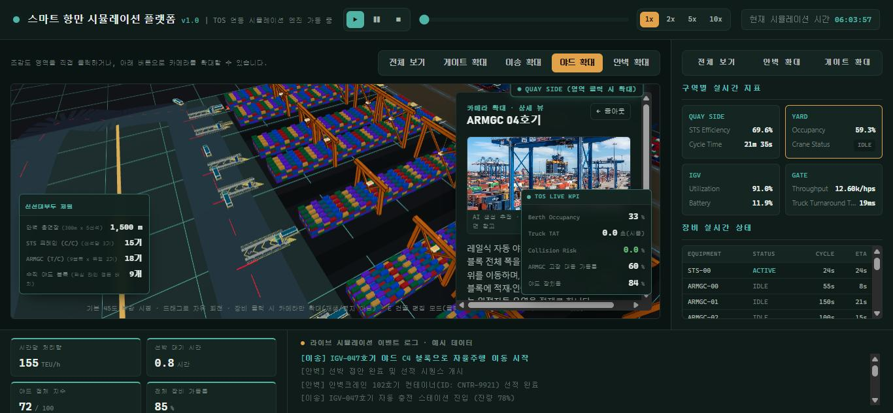

# 항만 터미널 자동화 3D 시뮬레이션 (Smart Port Terminal Simulation)

컨테이너 터미널이 완전 자동화됐을 때 선박 입항부터 게이트 반출까지 — 안벽크레인(STS), 자동 이송장비(IGV/AGV), 야드크레인(ARMGC), 게이트가 실제로 어떻게 움직이는지를 브라우저에서 3D로 재생해 보여주는 시뮬레이션입니다.

보고 자료의 정적 다이어그램 대신, "장비가 실제로 어떻게 돌아가는지"를 눈으로 바로 보여주기 위해 만들었습니다.



## 주요 기능

- **전체 흐름 뷰**: 안벽(QUAY) · 이송(TRANSFER) · 야드(YARD) · 게이트(GATE) 4개 구역을 하나의 3D 씬에서 조감
- **구역별 확대**: 게이트/이송/야드/안벽 버튼으로 카메라가 해당 구역으로 확대 이동
- **장비 클릭 드릴다운**: 크레인·AGV 등 장비를 클릭하면 상세 뷰(참고 사진 + 설명)로 확대, 줌아웃하면 전체 흐름으로 복귀
- **TOS 연동 가상 KPI**: Berth Occupancy, Truck TAT, Collision Risk, 장비 가동률 등 실시간처럼 갱신되는 지표 패널
- **라이브 이벤트 로그**: 장비별 작업 이벤트(안벽크레인 선적, IGV 이동, ARMGC 배치 등)를 타임라인으로 표시
- **재생 컨트롤**: 재생/일시정지/정지 + 1x~10x 배속

## 기술 스택

- [React 19](https://react.dev/) + [TypeScript](https://www.typescriptlang.org/)
- [Vite](https://vite.dev/) (빌드 도구)
- [React Three Fiber](https://r3f.docs.pmnd.rs/) + [Three.js](https://threejs.org/) + [drei](https://github.com/pmndrs/drei) (3D 씬)
- [Tailwind CSS v4](https://tailwindcss.com/)
- [Recharts](https://recharts.org/) (모니터링 그래프)
- [Framer Motion](https://www.framer.com/motion/) (UI 애니메이션)

## 로컬 실행 방법

```bash
# 의존성 설치
npm install

# 개발 서버 실행 (기본: http://localhost:5173)
npm run dev

# 프로덕션 빌드
npm run build

# 빌드 결과물 미리보기
npm run preview
```

Node.js 18 이상을 권장합니다.

## 프로젝트 구조

```
src/
├── components/
│   ├── scene/     # 3D 씬 구성 요소 (크레인, AGV, 게이트, 야드 등)
│   └── ui/        # 2D UI 오버레이 (KPI 바, 상세 패널, 이벤트 로그 등)
├── data/          # 경로·장비·상태 더미 데이터 (하드코딩, 실데이터 미연동)
└── types/         # 공용 타입 정의
```

> 현재 버전은 MVP 단계로, 모든 장비 위치·이벤트·KPI는 로컬에 정의된 시뮬레이션 데이터입니다. 실제 TOS/IoT 시스템과 연동되어 있지 않습니다.

## 배포 (Vercel)

이 프로젝트는 정적 빌드 결과물을 서빙하는 Vite 앱으로, Vercel에 바로 배포할 수 있습니다.

1. GitHub 저장소를 Vercel에 import
2. 빌드 설정 (Vercel이 Vite 프로젝트를 자동 감지하지만, 수동 설정 시):
   - **Framework Preset**: Vite
   - **Build Command**: `npm run build`
   - **Output Directory**: `dist`
   - **Install Command**: `npm install`
3. 별도 환경 변수(.env) 없이 빌드 가능 — 외부 API 키 의존성 없음

CLI로 배포하는 경우:

```bash
npm i -g vercel
vercel        # preview 배포
vercel --prod # production 배포
```

## 참고 이미지 출처

`src/assets/refs/`의 장비 참고 사진은 실제 터미널의 자체 사진이 아니며, 형태·배치 참고용으로 수집한 이미지입니다 (`src/data/photos.ts`의 `sourceNote` 참고). 일부는 AI 생성 이미지로 추정됩니다. 저장소를 공개로 유지하기 전에 각 이미지의 출처·사용 권한을 다시 한번 확인하는 것을 권장합니다.

## 라이선스

별도 명시 전까지는 개인/내부 프로젝트입니다.
